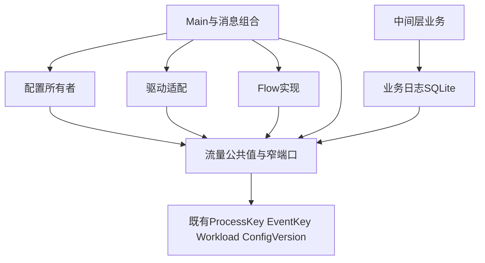

# 模块功能边界

本文只确定功能归属、接口组合和依赖方向；细节分别以各模块技术契约为准。底层主模块通过[MainContext](contracts/main-context.md)及明确参数组合底层模块；内核驱动通过协议接收数据并维护自己的DriverContext。两个大模块不共享运行时上下文，不在叶子模块内部追索其他实现。

## 配置模块

独占实际后端位置的一次定位、自保根／固定路径派生、配置读取／校验／原子写入、唯一只读缓存和DriverConfigImage导出。主模块首先调用其initialize，其他模块只接收它提供的数据，不重新定位目录、不重读配置、不缓存另一份设置。

InstallLayout私有，目录定位所需的OS查询封装在配置模块内部；驱动OS适配只负责驱动资源，不变成所有平台查询的公共服务。公共路径与上下文只是共享契约数据，不是新的目录服务。模块专属设置由主模块调用配置接口取得后作为参数传给相应模块。接口见[配置契约](backend/configuration/technical.md)。

## 规则模块

独占普通规则源读取／校验／写入、三类工厂、匹配、平台规则编译及规则版本租约。通过初始化上下文取得既有规则文件绑定，通过参数接收驱动能力；不引用配置或驱动模块实现，不自己建驱动连接。

规则命中信息是输出，进程树更新和日志落盘分别由相应模块承担。配置来源文件自保规则不再被规则模块读取和保存一份。接口见[规则契约](backend/rules/technical.md)。

## 内核驱动大模块

独占实际hook、驱动快规则、原操作保管／等待／答复、内核投影的真实采用与实际状态。内部DriverContext和各子类只以[驱动契约](drivers/technical.md)为准，不复用MainContext，不读取底层配置／规则文件，不接管进程树或协议内容解析。

驱动通过原生端点接收镜像和控制命令，发送约定事件／回执；原生Messages不是底层MainMessages。快规则直接裁决；ToUser保管原操作上抛等待；Observation只上报。具体[两个大模块边界](drivers/architecture.md#两个大模块的边界)代表代码归属。

## 底层驱动适配

属于Rust底层：实际加载／核验驱动、管理用户态FD／HANDLE／BPF link、编码发送与异步接收，向底层暴露DriverSession／OriginalOperation。它通过协议连接驱动，不直接调用内核对象方法，不创建DriverContext，也不编译规则或发现配置路径。

接口与DriverConnectInput／DriverInitParts只在[底层适配契约](backend/driver-adapter/technical.md)定义。主模块把配置／规则公开结果组合后交它，适配把实际驱动回复交回主模块；初始化失败停止，不以软件供给或观察替代。

Agent 覆盖按三条现有职责组合：系统操作由驱动与规则处理；LLM 协议与凭证由 Flow／凭证处理；旁路采集由驱动及驱动适配提供原始系统／执行事实，中间层组合操作系统交接与明确行为模式。原始采集不要求预先识别ToolCall，不依赖共享SDK、Agent私有函数或固定调用栈形状。运行时读取确需布局时按实际映像／ABI核验；该技术不成为全部原始事实的先决条件。现有消费结构与未实现入口见[原生采集边界](backend/driver-adapter/technical.md#原生请求持续采集与工具边界)，模式职责见[原证据组合](middleware/audit/technical.md#原证据定位与组合)。

## 主模块与其消息封装

独占初始化顺序、三个执行职责、队列接线、公开接口组合、上下消息路由、共同控制及生命周期。依次调用模块接口，组合不可变输入，等待实际结果；不做配置文件操作、目录定位、规则编译／匹配、事实扫描、协议解析或日志持久化。

消息封装属于主模块，拥有中间层和驱动两个端口。它不变成另一套配置／规则／驱动业务实现。其他模块通过接口参数接收数据，或通过显式注入的窄输出接口返回结果，不查主模块全局状态，不建立服务定位器。接口见[主模块架构](backend/main/architecture.md)。

小型共用函数只有在没有既存业务所有者时才归Main的global；它只供组合层通过明确参数调用，不持有全局可变状态，也不成为叶子模块导入Main的入口。叶子模块共享值仍归公共契约；需要执行的能力按已有窄接口传入，不建立GlobalServices对象表。存在独立I/O、持久化或生命周期的能力回到所属模块，规模较大且独立时单独封装。当前[缺口归属](backend/gaps.md)中的运行时修正均有现存所有者，因此不新建空global类或通用服务框架。

## 公共契约

底层的共享数据、模块边界接口及MainContext声明放在公共契约层；不引用功能模块实现，也不包含读文件、目录发现或调度代码。驱动消费同一协议规范的原生表示，不导入Rust底层实现；DriverContext为驱动私有结构。主模块可引用各模块公开接口；功能模块仅依赖公共契约和自己的实现／成熟基础库，不因传参而导入对方实现。

模块公开的只读数据可作为参数传递，这属于正常接口协作。主模块只组合和转交，不能改用可变全局上下文、万能key/value、模块对象集合或回调注册框架。

## LLM模块的单向依赖

公共类型／窄端口以[流量公共契约](contracts/flow.md)为叶子定义；该页不引用Flow、驱动适配、消息、配置或存储实现。类型定义先于消费者，不用两页互相“见另一页”补全一个结构。

箭头表示实现／类型依赖，不是事件流向。当前驱动适配向AdmittedConnection队列移交真实连接事实与独占字节流，Flow只接收同一公开结构；返回数据不要求驱动导入Flow或Flow导入Main。被动CaptureEvent不是当前接口。Flow输出只有原ChatReceiver一个消费队列；Main通过消息模块的专用聊天消费入口直接移交，复用既有Messages任务，不与控制结果混队。中间层业务日志消费原记录并结构化持久保存；前端按已提交索引单条读取，不回调Flow解析或读取私有状态。配置可以使用公共ProviderProfile等值，公共值不引用整个FlowSettings或ConfigModule。

内聚边界明确到状态所有者：探针和ABI关联归适配；HTTP／SSE及单exchange消息状态归Flow；业务会话图／工具因果关联归中间层；底层原连接授权归 Main、外部接入与订阅归中间层；业务持久事务归中间层业务日志；秘密映射和范围校验归凭证所有者。禁止同时存在两份可写连接表、聊天库、规则池或容器身份缓存。

底层同进程端口使用类型化值和不可变共享引用；向前端／IM输出的JSON组装归中间层接入。Flow对上游实际JSON／SSE只作原协议解析和保真投影，不主动脱敏，不再让中间层解析同一协议。当前JSONL接入适配与目标正式宿主的边界见[内存路径](middleware/audit/architecture.md#内存路径与json边界)，未完成的授权接线不能以零拷贝为由绕过。

## 进程树模块

属于Rust底层，由主模块初始化并注入同一FastFacts及只读查询入口。独占整机进程扫描、实例身份、初始／最新两份属性、父子索引、命中归集和刷新；只经传入窄端口核实原生事实，不导入驱动实现或另开连接。主模块不扫描/proc，规则模块不自行查询进程树；快速匹配所需事实先由主模块合入同一事件。当前实现与接口见[进程树契约](backend/process-tree/technical.md)。

## 其他能力的边界

底层安全日志负责规则命中与系统安全审计；中间层业务日志独占 LLM 聊天、工具、关系、Ask 业务数据的结构化数据库。Flow 负责当前 TLS／协议解析及真实投影，消费完即释放；底层不保存另一份聊天历史。可选TLS中介在用户态独占真实连接和修改，驱动只做来源采样／网络导向。公共DTO及边界归[联合架构](backend/flow/architecture.md)；CA私钥归凭证所有者，经Main注入窄端口，Flow不自行存key。幻影key由凭证模块与同一TLS出口协作，MCP暂缓；剩余未定点进[存档](archive/unresolved-module-contracts.md)。

不因这些模块尚未开发就在主模块补一份实现或让它们返回假成功。待明确项不是当前交付前必须额外补齐的门槛；进入对应模块开发时，先明确其契约再接入。

## 固定规则拒绝反馈

固定文本与原命中版本归规则模块；Driver只提供真实拒绝及必要上报。Main只以原PolicyLease和公开接口组合，不能匹配、生成文案或推工具因果。执行反馈是中间层的独立内聚子模块，消费活动视图的明确关系；问询协调不代为反馈。Flow只保管限定写入上下文、定位协议字段、改写和报告真实提交；公共结构只在[Flow公共契约](contracts/flow.md#固定规则拒绝反馈目标契约)定义，不依赖中间层DTO。它不增加第二份规则、日志库、聊天库或Owner服务。

Agent发起者、证据关系、Ask最近20条及底层内存／中间层JSON边界统一遵守[审计分层](middleware/audit/architecture.md)，业务字段仅在[技术模型](middleware/audit/technical.md)维护，不另行定义。

## 消费、状态与日志边界

队列仅占用尚未出队的容器空间；出队即归还许可并移交原对象，消费者完成即释放。尚未完成的原操作、协议解析、SQL 或反馈写入上下文属于其执行者，完成前必须保管，不称缓存。进程树、配置和规则是必要实时状态，更新由唯一所有者维护；通用事件不保留回放快照。

中间层数据库通过配置唯一派生的固定路径初始化，所属模块执行真实事务；前端、IM 和目标 Agent 不获得任意路径或写库能力。底层配置／规则／秘密继续由各自模块修改，不迁入业务库。详见[业务日志](middleware/business-log/architecture.md)与[底层安全日志](backend/security-log/architecture.md)。

[Agent 调用图谱](middleware/agent-graph/design.md)已有本地原件分析入口，按原证据组织运行视图。模型终态、进程关系和实际任务完成各有独立出处。
