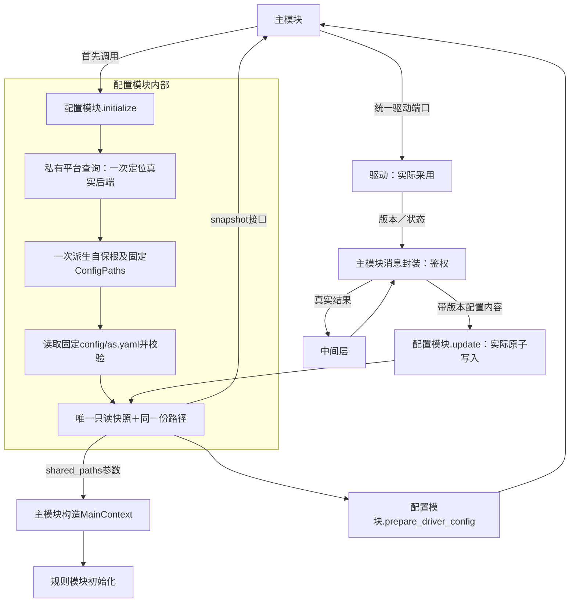

# 配置模块架构

公共引用：[MainContext公共上下文](../../contracts/main-context.md)、[模块唯一职责](../../architecture.md)。公共定义以链接目标为准，本页不另定义一份。

产品边界见[设计](design.md)，字段与接口见[技术契约](technical.md)。主模块调用配置模块，不代替其文件操作。

## 初始化与路径

主模块首先调用ConfigModule::initialize()。配置模块内部一次查询实际后端位置、按固定布局派生自保根和ConfigPaths、绑定并读取固定配置，然后校验和缓存。InstallLayout是模块私有数据，不由主模块或外部平台服务提前取得并传入。主模块随后通过snapshot()读取配置、shared_paths()取得同一只读路径引用，组合MainContext并按依赖顺序调用其他模块。

snapshot()返回唯一配置源的不可变快照和同一份ConfigPaths；主模块及其他模块不自行定位、拼根或建立第二个路径缓存。ConfigPaths只读且不可由UpdateConfiguration修改；所有写入固定绑定原配置源，规则模块只通过接口参数MainContext使用其中已有rules_file，不引用配置模块实现。不从中间层或配置正文重解释写入路径。

## 持久配置与内核投影

配置模块导出DriverConfigImage：持久启动默认、来源资源设置，以及固定目录的文件自保规则。规则模块独立导出DriverPolicyImage；主模块只组合公开结果。驱动验证两个镜像后形成一次一致的持久状态，不能部分安装。

自保系统规则只属于文件类驱动池的只读组1，文件驱动组2为同源维护放行，普通文件驱动组从3开始。系统组校验真实受控修改权限并拒绝其他主体修改；通过权限检查的Open继续匹配原文件池维护规则；普通读访问仍受OS权限及明确规则语义约束。不新增另一套可编辑普通规则源或第四类池。

底层真实执行自保内文件修改。配置模块写配置、规则模块写规则、其他模块写自己管理的文件；中间层不能拿到写权限，也没有任意路径WriteFile命令。自保允许的主体是驱动验证的底层实例，不是消息中自报的角色或PID。

## 保存与采用

配置模块串行执行版本检查、完整校验、同目录临时文件写入／同步／原子替换，再发布唯一缓存；失败不发布假候选。开始后的真实任务保管管理锁，即使调用方取消等待也完成保存或返回实际错误。

主模块在消息职责内串行组织配置／规则的持久变更，防止两个模块各自取旧镜像后覆盖对方更新；磁盘锁和内容校验仍在各自模块。驱动采用结果由真实回执确认，不由保存快照推定。

保存成功但驱动采用失败，配置快照表示真实已保存内容，驱动状态表示真实旧有效内容；整体修改报告失败并附这两个版本。主模块不发明跨文件／内核的通用事务、自动回滚或第二份可写缓存。不能热改变的项目明确要求重新初始化，不自动重启。

临时开关不调用配置保存接口；主模块负责其上行／下行，驱动上报实际值。持久重载保持临时覆盖，完整初始化清空覆盖并采用最新持久默认。

单独重载配置或重新初始化驱动不重新定位目录。驱动对配置提供的目录绑定实际内核对象，是验证和使用这份结果，不是第二次发现自保根；不得从驱动／适配程序自己的位置另算一套。
