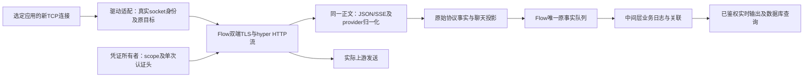

# LLM流量模块与驱动联合架构

当前架构以已实现受控入口为主线。产品边界见[设计](design.md)，公共DTO和跨模块端口只在[公共契约](../../contracts/flow.md)，Flow私有状态只在[模块封装](technical.md)，消息封套在[消息契约](../main/messages/technical.md)，配置在[配置契约](../configuration/technical.md#flow运行时配置)。MCP方向暂缓，不作为本模块初始化或交付依赖。

## 两个大模块的职责

- **内核驱动**：复用真实进程／socket身份和现有HIPS执法；受控入口只采集实际进程／socket身份、原目标和接纳状态，完成明确对象范围的数据面导向。被动TLS库采样未实现。不做TLS密码运算、HTTP／JSON解析、聊天聚合、存档或内容改写。
- **底层驱动适配**：持有BPF map/link和原生端点，核验root拥有的入口资产及跨进程凭证，接收真实连接及生命周期；经同一已鉴权DriverSession组合入口交给Flow。无正文日志，不另开未鉴权采集服务。
- **Flow底层模块**：内部按输入来源、HTTP解码、provider编解码、单条消息投影／发布拆分职责；只有模块边界暴露窄接口，不为每一层建立服务／总线。当前TLS中介拥有自己的两段TLS和HTTP传输，向同一provider层交正文事件，并独占真实写出。
- **中间层**：基于底层原始协议记录、原生ID和实际操作事件建立业务会话／工具关联；关联结果不反写底层原始记录，缺少执行上下文保持未知。
- **中间层业务日志**：消费原聊天、工具和业务关系并结构化持久保存；查询只读原库，不另建历史缓存。底层安全日志独立承担系统安全审计。
- **Main及消息封装**：组合配置、进程事实、驱动适配、Flow 输出；负责底层连接首次鉴权、权限与公开端口组合。它不解TLS、不解析LLM正文、不自己持第二份聊天库。
- **配置／凭证／规则**：配置独占路径和非秘密设置；凭证模块独占秘密、phantom映射和CA，向中介提供CredentialPort／CertificatePort及一次性私有租约。规则仍独占三类规则，不因解析聊天而新增第四池或隐式审批动作。

## 数据链

当前只有一条中介正文来源；未实现的被动采样不出现在活动接线中。中介自身上游连接必须用真实进程／连接标记排除再次导流及重复观测，不能靠进程名永久豁免。进程未知时保持未知，不能把中介PID冒充原应用。HIPS已有放行／拒绝与本模块状态独立，不因来源不可见自动关闭防护。

每个实际 HTTP 方向的观察器构造一份不可变公共来源，所发布的原协议单元和聊天消息引用该来源。消息槽是该方向内唯一的可变内容所有者，按已选协议更新本帧涉及的内容部位。完整边界快照、部位增量及原协议字节沿同一队列移交，中间层用原事实引用建立业务关系。具体结构和终态见[在途消息的所有权](technical.md#在途消息的所有权)。

AS自身出站维护流量通过同源的网络Driver维护规则静默放行，不进入自身ToUser。导流BPF的控制器排除只负责防止重复重定向，不能替代这些普通规则；范围和编号见[规则设计](../rules/design.md#as-维护规则)。原Agent连接仍按其实际进程与网络规则处理，TLS校验和凭证范围不因维护放行改变。

## 运行时接入与调度

以下顺序属于 AS 内部初始化。目标应用可以已经运行。受控 TLS 连接的起点统一按[出口契约](tls-egress.md#支持范围与成熟依据)认定，容器后启动接入的产品目标见[动态接入](container-egress-design.md)。

Main首先初始化配置、规则并完成真实Native鉴权／采用，自保Running后再初始化会创建私有文件的凭证所有者；业务就绪前准备Flow并启动入口。Main读取FlowSettings并调用各模块接口；只向实际需要路径的适配／凭证所有者传共享路径。Flow只处理数据，不接无用MainContext。驱动必要能力及原有初始化仍遵循现行失败停止语义。入口只有完成真实载入／绑定后才报告就绪；Flow开关值不代替实际能力。中介模式先让Flow接收端、CA及凭证端口实际就绪，再由驱动适配启用接纳／导流，失败清理本轮资源，不改用户信任配置。准备凭证和写认证头不等待中间层业务关联。

中介模式调用当前DriverSession.start_tls_ingress并连接AdmittedConnection队列；输入只有真实原连接事实和独占字节流。被动来源的start_tls_capture／CaptureEvent仍为归档草案，不是当前Rust接口。容器实例发现／被动库绑定的后续工作不能由Flow自行扫描或从名称推导。

保留现行三条执行职责：驱动回调只做快速事实／规则；主循环保留原问询；第三消息职责承接异步入口消费、Flow 原事实移交和控制。Main把唯一ChatReceiver直接交同一MessageModule.consume_chat，聊天消费者沿业务库等待真实SQL提交，控制收发与问询答复沿各自原任务推进；不增加MainMessage聊天转发队列。TLS会话和各HTTP stream使用异步任务，不为provider、容器或消息增设专属线程。CPU解析采用有界批次，只有真实开销证明需要时才增加有限工作任务。

同一连接的TLS字节／HTTP2 HPACK状态由一个任务顺序维护，分流后各stream保持局部状态；不同连接独立推进。注册／移除连接及不可变设置切换用短临界区；锁内不做TLS、解析、网络发送、存储、进程查询或等待用户。新配置作用于新会话，在途会话持原快照，显式停止后报告未完成状态。

## 队列、压力与退出

入口队列、当前解码状态和唯一消费队列分别有界；控制／原操作答复保留原有优先容量。不能让聊天洪水堵住HIPS回执。入口拒绝、解析和投递丢失由实际所有者分别报告；外部慢客户端由中间层接入处理；历史只从已提交数据库查询，不从底层回放恢复。SQL 失败不能宣称 Stored。

中介模式拥有真实传输，按HTTP流控对尚未提交的字节施加背压，但不因为前端没人看而等待。解码超限保留Gap并停止该方向投影，原传输字节继续按HTTP语义转交；限定反馈无法修改时保留原工具结果并报告真实失败。队列真实关闭及实际写入错误仍向原任务传播。当前写功能只有 phantom 认证头替换及有明确来源的限定固定拒绝反馈，任意聊天正文编辑不启用。已开始写出由原会话任务收尾，取消与提交用同一次状态转移，禁止重放请求。

关闭时先停止新增导流接纳，显式Stop取消原网络任务并等待其及已移交事实收尾实际退出；普通运行等待原I/O结果或真实对端结束，不增加AS网络或排空计时。取消不覆盖已取得的provider Complete，实际未完成方向保留原缺口；原连接及BPF link由真实所有者释放。停止采集不杀目标、不关闭外部Root broker。中介已接管连接不能无缝切回原TLS会话，关闭必须如实结束。消费完的底层事件立即释放；重启更换来源代。中间层重开原数据库查询已提交记录，不恢复旧授权／原操作。

## 重用与规模

复用现有ProcessKey、DriverSession、MainContext、消息鉴权及配置所有者；新增代码只承担来源接入、协议绑定和聊天语义。TLS／HTTP协议栈采用成熟实现，依据见[源码调研](references.md)。不复制Go／Python整套服务，不给参考项目的CLI、sudo启动器、抓包文件导出或keylog功能建立兼容层。

公共契约不导入模块实现；实现依赖图以模块边界文档的单向关系为准。ProtocolObservation保留原生ID／已获原始字节和出处，ChatMessage只是同一事实的展示投影。中间层的会话／工具关联不作为底层采集、凭证范围校验或初始化输入，避免底层等待中间层又反向依赖底层数据的环。

## 原数据公开边界

Flow把实际原协议字节和同一来源的规范内容交给已有鉴权内容通道；Codec保持真实值，发布和中间层存储不主动脱敏或改写。原字节、已解码字段和真实缺失各有原契约，不以一个内容标记过滤同单元其他消息。没有脱敏匹配器、隐藏字段DTO、内容遮蔽服务或因此产生的消息中断。

模块、线程、端口、采集范围和数据结构沿原边界；具体当前接口见[技术文档](technical.md#原数据保真)。历史问题及原失败保留在[证据](../../evidence/flow-redaction-readability.md)，旧脱敏方案不再作为开发目标。

Docker OpenClaw联合场景同时需要phantom与聊天观察时，共用一个真实TLS中介出口即可同时提供写认证字段和读取正文的能力，不要求同时运行另一套被动正文来源。凭证替换仍由独立所有者授权，底层不把上层的关联猜测当授权依据。
