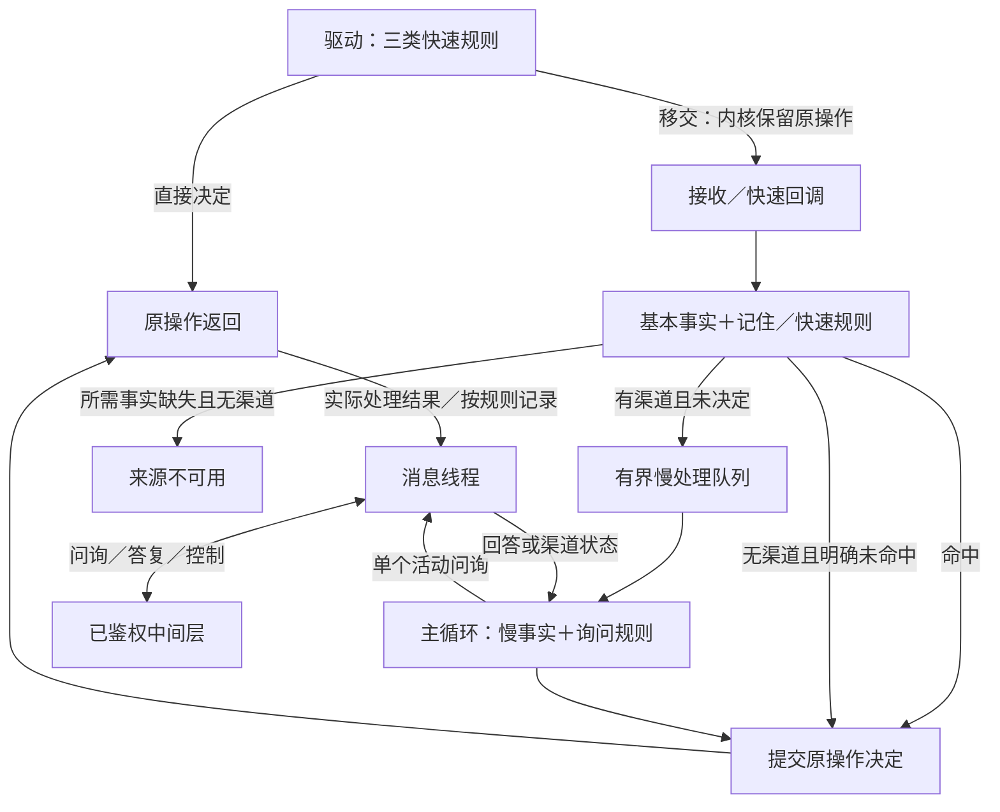

# 主模块架构

主模块统一装配、入口分流、模块调用与启停。产品行为见[产品设计](design.md)，接口见[技术细节](technical.md)，内核原请求见[驱动架构](../../drivers/architecture.md)。驱动通信的初始化调用顺序见[通信架构](../../contracts/driver-communication/architecture.md)。

## 初始化

主模块是初始化入口，首先调用ConfigModule::initialize()。配置模块内部一次定位真实后端、派生并缓存自保根和固定路径、读取／校验／缓存配置；主模块随后调用snapshot()读取配置、shared_paths()借用同一路径引用，组合MainContext交规则模块初始化；规则模块只使用已有rules_file。主模块不另取目录、拼接路径、直接写文件或自行编译规则。

主模块消息封装建立并鉴权驱动连接，读取真实能力，再分别调用配置模块prepare_driver_config和规则模块prepare_driver_policy。配置模块提供持久配置与文件自保规则，规则模块提供三类普通驱动规则及版本租约。主模块接好回调和三个执行职责的队列，初始化唯一进程树并完成观察前置、整机扫描和消费栅栏，再调用驱动初始化接口应用两个模块结果，确认实际版本／默认开关／自保状态后才宣布业务就绪。完整顺序见[通信架构](../../contracts/driver-communication/architecture.md)，公共传参见[MainContext](../../contracts/main-context.md)，职责按[模块边界](../../architecture.md)收口。

消息封装在主模块内，包含中间层端口和驱动端口；负责共同开关／状态的鉴权、命令关联、转换和转发。中间层下发的临时开关必须等驱动执行确认，驱动上报的实际状态再由底层转发中间层，不能用配置默认值或“已发送”代替。

失败按已取得资源逆序清理，不增加初始化注册框架。平台生命周期端口只处理本机资源，不能替配置／规则模块初始化业务数据；不停止已有LSM或外部Root broker。

## 三个执行职责

1. **接收／快速回调线程**：接收驱动请求，按事件类别调用进程、文件、网络三个接口；FastFacts补快速事实，RulesFactory选择一次不可变类别快照，匹配记住与快速规则。命中即回送原操作决定；仅在有可用交互渠道时，将未决定请求移交慢处理队列。无渠道时只执行快速路径；判定所需事实缺失返回Unavailable，明确未命中则不拦截。这里不等待用户、不读数据库、不计算文件哈希。
2. **主线程／主循环**：顺序消费慢处理队列，先检查交互渠道；无渠道时跳过慢处理，否则调用已接入的慢事实实现及规则模块；缺失事实补齐后先保持原优先级，再进入询问池。同一时刻只有一个活动人工问询，使用可取消的异步等待；该问询收尾后才消费下一项。队列中的其他原操作仍由驱动保管，过期和来源取消不依赖被选中展示。
3. **消息线程**：双向通信、用户答复、查询、控制命令、辅助原件消费、聊天消费和日志分发。辅助驱动原件经原events出口消费，生命周期／计数／事实栅栏再交Fast入口维护；原生请求返回、交接和futex选择直接交消息模块，不挤占完成／状态队列。聊天直接使用Flow唯一原队列交同一消息模块；阻塞的保存／查询交对应模块的受控工作任务，不能阻塞回答和停止处理。两个驱动职责出口及唯一接收泵的边界见[主模块技术契约](technical.md#统一事件编码)。

这三项是用户态职责，不是内核hook的线程模型。多个任务可同时进入不同LSM回调；LSM实现负责注册实际hook，AS驱动适配模块接入其现成控制接口，用户态接收器轮询实际FD。三类规则池不派生三条询问线程，不新建通用总线。

内核等待与用户态等待不同：ToUser之后，发起任务在合法的内核上下文中等待；用户态快速回调即使马上给出决定，也是在答复这个原请求。主循环的人工等待不会停止接收其他快速事件。

## 模块接口与状态

- FastFacts负责读取原事件、更新进程事实并返回快速内存补充；主模块只填空后再匹配。SlowFacts预留异步补充接口，实际接入后在成功时只填空；当前正式装配为None。进程树的初始化、两份视图和查询设计见[进程树架构](../process-tree/architecture.md)；当前由MainAssembly初始化唯一实体模块。
- RulesFactory／RulesModule封装三类、快／询问两池、渠道可用性以及优先顺序；主模块不实现第二份匹配算法。
- OriginalOperation只代表实际执行点保管的原请求，验证绑定、提交决定并返回真实回执；事件序列化数据不具备执行权限。
- MessageModule消费内部完成和状态，底层安全日志独立消费SecurityLogEntry（RuleLogRequest包装为Rule，驱动写关闭包装为FileClose）；主模块消息封装持有认证会话，配置／规则修改分别由所属模块校验、真实保存和导出；不会给中间层自保写权限。

每个请求保留原事件、操作身份、源有效期和选定规则快照；不使用共享“当前PID／容器”。规则更新不修改在途快照。等待用户不持有规则管理锁、队列锁、进程树写锁或驱动全局锁。

底层同一在途操作由 `Work` 保管，队列传递其所有权。事件主体使用 `Arc<EventData>`，完成通知、规则日志和对外结果共享该只读值。取得原生事件后建立底层副本，驱动继续保管内核原操作；适配为原操作校验保留的原始事实与后续补全视图各有明确用途。快速／慢速补全只填缺失字段，通过 `Arc::make_mut` 取得写入权；事件发布后各消费者共享同一只读值。Ask 决定、驱动实际回执及持久化结果仍按各自真实阶段填写。

出队把操作上下文移交给消费者，Ask 等待和执行期间继续保管。完成通知与日志消费结束后释放各自引用，最后一个持有者释放事件内存。排队期间不另外保存事件历史或建立数字索引所有者表。跨驱动边界仍使用现行通信封套和 `EventKey`。

## 队列与并发

快速输入、慢处理、控制答复和普通日志使用独立有界接纳。普通日志积压不能阻断答复；不猜未知容器归属为宿主机。来源公平／配额机制和实际额度尚未明确，先[存档](../../archive/unresolved-module-contracts.md#来源公平与资源分配)，不让主模块补配额服务或增加验收门槛。

FlowRuntime将唯一ChatReceiver直接交给同一消息模块的聊天消费入口，复用原聊天消费任务和JoinHandle，在Messages OS线程异步执行，不经MainMessage中继、不新建聊天队列／Owner。无前端仍保存事实；前端从中间层已提交数据库读取，普通流量背压不得关闭问询身份。接口、部分帧和真实过期答复能力的边界只在[消费端口技术定义](technical.md#消息与聊天消费端口)维护。

所有排队原请求都有来源取消和截止处理；主循环只展示仍有效的请求。队列满时由原执行点明确收尾，不能丢弃原操作引用或把Busy当允许。已命中询问规则按该规则收尾；尚未匹配规则的基础设施失败不伪造RuleHit。

规则log=true时才生成规则日志请求。消息接纳与安全日志写入失败分别报告，不改写已作出的裁决；进程生命周期事实不能作为普通重复日志被随意抑制。

已接纳原操作的完成由原异步处理ctx持有，沿现有有界完成通道等待消费者接纳，不能因队列满而用try_send丢弃。它占用原ctx额度，不派生另一个任务／Owner或备用队列；内核原结果与这次投递分别认定。Direct实际结果与状态共用可靠的异步通知入口；普通日志保留独立容量和明确拒收计数。原生输入、原版本租约及取消收尾由同一Work保管，拒接纳也复用原FastInput与pending预算，不派生无界的观察／补偿任务。

## 退出和控制

RequestStop由原ManageService授权及urgent接纳进入消息职责，在原短认证临界区复核后同步交唯一宿主oneshot。宿主一次接管后，原命令任务返回Accepted即结束tracker工作，不等待自己的shutdown。MainThreads在MainMessages组合前仅绑定一次真实监听端；端口缺失或断开不接纳，不建立第二退役Owner、信号总线或MainContext可变状态。接口和运行时回执能力只在[停止请求契约](messages/technical.md#停止请求与真实退出)定义。

宿主收到请求后先封外部接纳、关闭原管理授权，并继续poll原session，等待非敏感Accepted真实写出、session结束或显式终止信号，不设额外计时截止。随后沿原MainThreads退役与内容排空继续现有依赖顺序；原订阅在清理期间继续由宿主驱动，具体接线见[停止请求契约](messages/technical.md#停止请求与真实退出)。不能让消息命令await包含自身drain_commands的退役，也不能用关闭callback广播代替资源退役。真正的退出证据来自父进程／服务管理器当前实例的wait结果。

停止接纳后，已有问询按原规则动作收尾，其余请求由原执行点取消／失败处理。进入OriginalOperation::apply后的执行必须由实际任务保管至返回，不能因UI断开或等待者被取消而遗弃。处理ctx排空期间消息worker仍接纳完成；驱动及迟到producer退役后才排空、关闭消息worker，避免sender等满队列而consumer先退出的环。独立退役任务排空工作并join实际线程，最后关闭驱动会话；消息worker不能等待自己的退出。

功能关闭调用驱动改变实际执法状态，不只隐藏展示；共享身份事实仍由所需模块维护。驱动通过安装包在当前内核上部署BPF对象及可加载支撑模块，不更换内核；不能把UpdateDriver命令接纳写成替换成功。控制命令和完成语义见[消息架构](messages/architecture.md)。

## 持久、临时与大消息

配置模块下发持久配置和固定文件自保规则；规则模块下发普通DriverPolicyImage。主模块串行组织持久更新，并通过同一驱动端口分段发送完整镜像，完整校验后才采用。临时开关不写盘、不走持久保存队列，直到手动恢复或完整重新初始化。普通重载保留临时覆盖，暂停普通类别不关闭自保。

驱动实际状态是上报来源，主模块只观察、关联和转发；断线时只报告本机连接不可用并保留明确标注的最近确认记录，不猜当前驱动已关闭或仍正常。结构与收口见[统一消息契约](../../contracts/driver-communication/technical.md)。
