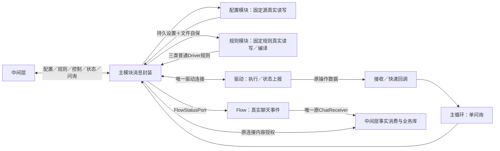

# 主模块消息封装架构

公共引用：[MainContext公共上下文](../../../contracts/main-context.md)、[模块唯一职责](../../../architecture.md)。公共定义以链接目标为准，本页不另定义一份。

产品行为见[设计](design.md)，上层数据见[技术契约](technical.md)，下层统一封套见[驱动通信契约](../../../contracts/driver-communication/technical.md)。

主模块私有消息组成有两个明确端口：MiddlewarePort处理认证会话和中间层DTO；DriverPort处理驱动会话、管理请求关联、分段buffer及上报。公共业务类型复用，操作系统差异留在薄适配。不独立建立消息业务服务、总线或Owner注册表。

入口认证一次，同连接复用身份，命令按角色授权。配置写和共同服务控制需ManageService，普通规则修改需规则管理权限。中间层不能给自己声明角色，不能直接写自保文件或驱动端点。

下行根据明确类型调用所属模块。持久修改在消息职责内串行组织，实际文件读写、编译、缓存和版本仍归配置／规则模块；主模块只取得公开结果并组织驱动采用。已经开始的任务由底层保管，消息等待方离开不遗弃。

临时开关、原操作回答、查询和退役有独立接纳机会，不等待持久发布及大buffer。驱动接收泵在接收／快速回调上下文完成短关联后，将管理回执／状态送给消息职责；等待者不阻塞同一队列的消费者。

驱动上报实际状态，主模块按实例和state_revision转发；主动状态和命令结果有各自用途，不重复计数为两次开关。断线可上报本机通信不可用，最近确认快照必须标为历史观察，不能代替当前状态。

原生OriginalOperation仍由实际驱动适配保管。问询发布前绑定原超时动作；答复／取消／超时竞争同一收尾，取回已完成真实回执不重发操作。普通日志由其消费者落盘和确认，不以消息投递冒充刷盘。

Main 将 Flow 原 ChatEnvelope 经唯一消费队列移交中间层，不建立聊天库／回放。中间层持久业务数据、真实订阅和 JSON 接入分别消费，底层保留真实 Connection 内容授权及窄执行能力；Ask／答复职责独立。定义见[Flow公共契约](../../../contracts/flow.md)与[消息契约](technical.md#flow-输出及内容授权)。

主模块生命周期组织停止，消息worker不等待自己的退出。Quiesce期间继续接收／回答，排空后关闭模块及本会话，保留外部Root broker。中间层断开和驱动失效分开，前者不能自动停用驱动。
