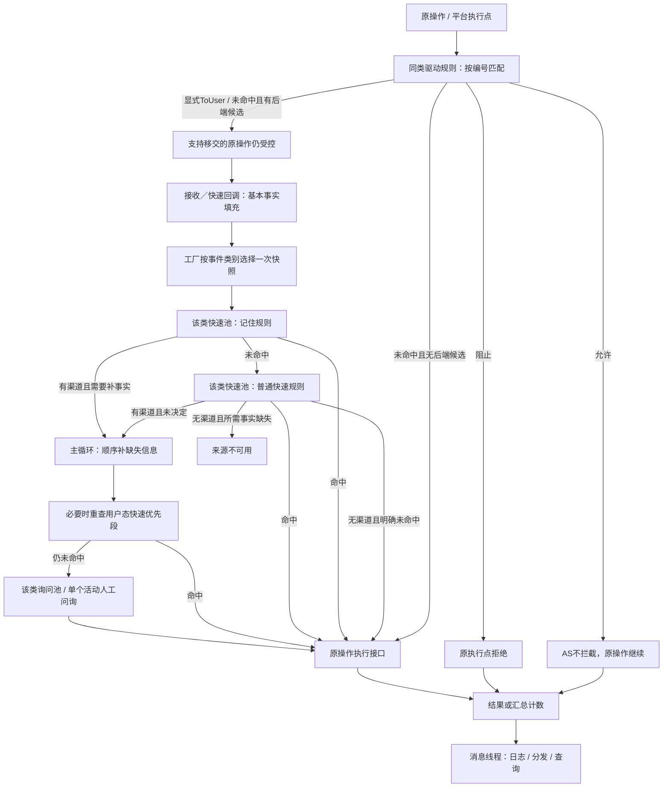

# 规则模块架构

公共引用：[MainContext公共上下文](../../contracts/main-context.md)、[模块唯一职责](../../architecture.md)。公共定义以链接目标为准，本页不另定义一份。

本文件定义模块职责、处理顺序与协作；用户行为见[产品设计](design.md)，字段、判定和来源依据见[技术文档](technical.md)。

## 1. 一个规则模块，两个执行位置

规则模块统一维护和校验驱动级、用户态级规则，生成同一规则版本下的不可变快照及驱动可执行表示。驱动保存编译后的执行数据，不成为另一套可独立编辑的规则库。配置模块提供唯一派生的只读路径，规则模块借同一ConfigPaths生成维护规则；主模块不解析规则文件、拼根或复制匹配状态。

按工厂模式选择ProcessRules、FileRules、NetworkRules三个派生；三个派生复用规则编号、条件校验和快照发布，不共享可被跨类别规则命中的匹配池。不增加动态插件注册中心或通用策略总线。

每个派生包含驱动规则列表和用户态的快速／询问两个匹配池。记住规则只是快速池中优先的来源分段；没有独立的第四个派生或第三个用户态匹配池。

驱动侧由三个派生分别生成进程、文件、网络三个独立的有序执行序列。事件先按kind选择唯一序列，再按组号／规则号匹配；命中后才根据规则动作分支到Allow、Deny或ToUser。驱动不形成“进程允许池、进程阻止池、进程移交池”等九个独立匹配池。

同类组内可以混合动作。界面的动作筛选是同一组数据的查询视图，不对应额外的存储、锁、队列或匹配器。内核物理map数量由执行点实现决定，不能用map分片改变逻辑顺序；规则副本仍只能由同一快照编译产生。

容器适用范围是每条规则的共同条件，不是第四类规则库，不按容器建立整套规则副本。作用范围只存规则一处，组不再设置可覆盖或继承的另一份范围。三个派生复用同一范围判定逻辑；从所有对象规则和当前容器规则筛出的候选，仍按原组号／规则号合并，不能先查容器专用列表再查所有对象列表。

原容器身份及其cgroup绑定由平台／容器事实模块提供，规则模块只消费只读事实并编译适用范围。原事件头中的actor_cgroup_id是关联输入，不直接等于持久容器身份。当前普通Driver规则只支持AllProtected，Containers范围采用前明确Unsupported；Backend使用已核验的原容器事实做范围筛选；主调度和规则模块不各自扫描运行时、解析容器名称或建立第二份容器状态。

容器的发现、生命周期与真实绑定由[底层驱动适配](../driver-adapter/technical.md#容器实例绑定)提供，不由规则或主模块重复扫描；规则保存的实例选择不会随名称复用而变化。进入裁决的请求固定原发起者归属，不在弹窗回复时用当前同名容器重新解释。尚未取得可靠归属时不能当作宿主机，也不能越过可能命中的优先容器规则去执行后面的宽泛允许。

## 维护组与唯一来源

PolicyEngine初始化首先从同一MainContext借已有ConfigPaths，读取固定rules.yaml，在规则owner内补齐三个实际维护组并校验全部用户组；内容变化先原子保存及确认，再发布该真实document对应的快照和版本。update／reload复用同一个规范化入口、同一管理锁和实际阻塞工作保管，不向DriverPolicyImage暗插另一份允许。

SourcePrefix和TargetPrefix用各自独立规则，仍经原Compiler、每类排序、Driver编码和真实安装；数据与优先级见[产品设计](design.md#as-维护规则)及[唯一技术契约](technical.md)。系统保留位置外的用户Driver组冲突明确失败，不自动重编号，不保旧文件格式适配。

内核自保类只保实际对象和真实exec身份的安全职责；身份准备／exec成功／退出跟踪不附带普通Allow。可用数据规则表达的文件／进程／网络维护放行只走三池，不再保留固定proc/sys读Allow、启动读Allow和网络hook特别分支作为失败回退。真实端点dev_t识别及其鉴权是通信入口职责，外部对象修改guard仍在普通规则之前。

## 2. 前置执行与主调度

图中的HOLD是平台能力要求，不是所有BPF hook天然具备的步骤。仅可观察的来源不能进入受控请求链；不能把LSM返回0再通知用户态画成“原操作仍在等”。没有用户态保管机制的执行点，只能提供其真实支持的驱动裁决和观察能力。

图中的每个规则匹配阶段都先在相同类别内检查该条规则是否适用于原发起者，再检查其他条件；命中后的动作和适用范围均不参与重排。保护边界决定事件是否属于AS管理，规则范围决定其中哪些事件可命中该规则，两者不互相替代。

驱动已裁决的事件以执行结果／普通事实进入消息与事实更新路径，不携带一个待再次执行的OriginalOperation。用户态只决定真正移交的原操作，不重复匹配驱动规则来推翻其结果。

## 3. 快速回调、主循环与消息职责

接收／快速回调根据统一事件头选择类别；填充快速内存事实，调用该类别的记住及普通快速规则。快速池不做文件读取、数据库访问或实时哈希计算。

只有存在可用交互渠道才进入慢处理；无渠道时不进行慢查询和询问匹配。主循环顺序处理询问，同一时刻只有一个活动人工问询。若前面的优先规则仅因可补字段缺失而尚不能判定，补充后先重新检查该优先段，再进入询问池，不因分线程而绕过优先级。规则模块封装此顺序，主模块不另写匹配算法。

消息线程处理交互消息、规则管理请求、日志与查询。规则修改通过消息下发给规则模块，后者串行构建候选快照；匹配路径只读不可变快照，不在热路径持有文件或管理锁。进程命中历史由事实模块记录，规则模块不另建进程树。

规则工厂通过既有MainModules.rules接入主调度，ProcessRules／FileRules／NetworkRules实现同一个RulesModule接口。配置模块先提供只读ConfigPaths.rules_file，规则模块异步读取固定config/rules.yaml、校验并编译，初始化后固定绑定该源，再供主调度选择快照。规则操作名与目标在类别边界类型化，不能把文件字段或execute操作装入网络规则。

普通Completed与RuleLogRequest分别进入现有独立有界出口。log只在规则中配置，命中时随RuleHit固定；主调度仅为log=true生成RuleLogRequest，并非所有Completed消息都写规则日志。底层安全日志通过SecurityLogSink在Messages职责消费并持久化；快速回调和主循环不写文件、不等待刷盘。日志拒收计入rejected_logs，必要完成通知的拒收统计独立，原执行结果不改写。

## 3.1 临界区和请求寿命

- 匹配只读取ArcSwap发布的不可变快照，每个事件保持选定的模块Arc；重载不在一次决定中混用新旧规则。
- update、reload共用一把异步管理锁；实际阻塞工作拥有该锁，包含期望版本检查、校验、文件替换与原子发布的整个临界区。调用方取消后，已经开始的工作仍持锁完成，不会让下一次保存／重载与旧工作交错。
- 文件读取、正则编译、序列化和写盘在阻塞工作线程进行；管理锁不进入匹配或用户等待。保存使用同目录临时文件、同步和原子替换，失败不发布无效规则。
- 交互请求使用有界队列和每请求一次性回复通道。连接计数的watch更新是短临界区；等待用户不持有它。所有渠道断开后即使马上重连，也不能使原请求复活，断开代数随连接状态一起更新。
- 原操作执行一旦进入apply就继续保管至其真实返回，接收方断开不丢弃执行future。关闭动作立即交独立退役任务保管资源，调用方取消关闭等待不能提前释放驱动。日志请求只携带快照数据和真实结果，不持有规则管理锁或重新查询当前版本。

## 4. 原操作、请求和记录分别负责

平台适配／执行模块保管原操作、源截止时间及真正执行结果。规则模块只产生动作或等待选择；主调度保管原工作直到完成。主循环顺序等待当前问询，接收／快速回调与消息线程继续工作；对被保护操作保持执行前同步控制。完整线程契约见[主模块架构](../main/architecture.md)。

决定输入和普通记录采用独立有界队列。普通重复记录允许节流汇总；待裁决请求不采样、不拿一个操作的结果替另一个操作收尾。事实更新需要的fork／exec／exit不能混入普通日志抑制；事实缺失必须显露，不能按当前PID猜补身份。

原请求容量或移交失败归平台执行模块，必须给出真实收尾，不能只返回Busy就遗失原操作。已匹配询问规则采用其超时动作；尚未匹配到规则的接纳失败不能擅自套用某条规则的超时动作，平台规则与失败行为必须在接入该执行点时明确。

## 5. 规则生效和管理边界

驱动与用户态使用一致的RuleVersion，驱动结果保留原命中的类别、组、规则与版本。候选规则先校验作用范围、顺序和执行点能力；不能执行的驱动动作直接报告原因，不自动迁到用户态、不静默缩小条件。

平台适配完成实际安装确认后才显示“驱动已生效”；用户态也不能把文件写入成功当成规则已采用。一次请求沿用其选定的规则快照，改规则不重建其原操作或重置等待时间。跨内核／用户态发布的一致性由技术文档约束，实际执行表示与安装确认由[当前驱动模块](../../drivers/architecture.md)执行，仍须按本轮实际产物与运行回执核实。

规则管理按级别和类别展示；记住规则的管理属于用户态快速池。把规则移到驱动级必须是用户显式修改，不能因后台优化让它取得更高优先级。界面查命中原因复用同一RuleHit及原执行结果，不维护第二份“预测命中”。

## 6. 规则管理消息与自我保护边界

前端／IM首次连接由消息通讯模块鉴权。服务端为会话授予ReadOnly或ManageRules，身份在同连接复用；修改命令仍逐次检查管理权限，这属于授权，不重新执行连接鉴权。客户端不能在规则命令里声明服务器路径、身份或权限。规则的Allow动作也不授予控制面管理权限。

主模块消息封装接纳Get／GetRule／Edit／Update／Reload，在消息职责内转交规则模块处理。规则读取、校验、编译、原子保存与发布只有规则模块一个owner；消息模块不写rules.yaml。对外修改没有“先只改内存，再另外保存”的双步骤接口。

规则实例和其消息入口固定绑定初始化源，消息模块不再持有一份可重解释写入目标的配置快照。运行期不允许配置正文或中间层修改规则源路径。Edit和Update携带编辑时观察的规则版本。Edit只在规则模块内对同版文档执行明确的组／规则修改，再复用update完成校验、原子保存和发布，不新增文件、索引缓存或第二个writer。单条查询的版本、组ID和规则取自同一不可变快照。规则模块在同一管理锁内检查版本、校验并原子保存，发布真实保存快照后返回RuleWriteReceipt；主模块完成必需驱动采用后才对中间层回复整体成功；旧版本请求返回Conflict，不能覆盖较新配置。读取返回同一快照的document和version。已接纳的写入不因连接断开或回复接收者消失而中途丢弃；客户端重连后查询实际版本。

源路径仅由配置模块内部一次派生并通过MainContext中的同一只读路径引用提供，规则模块只使用现成rules_file绑定，规则命令没有任意文件写入能力；规则源文件使用服务端权限和原子文件替换。运行期防止其他进程篡改规则源、AS程序和控制通道的内核保护归驱动自我保护模块；内存队列鉴权不能冒充对同UID恶意进程或root的完整防篡改。

## 驱动通信接入

主模块把配置模块同一路径引用组合进MainContext，再交PolicyEngine初始化（三类工厂实例，非单类别RulesModule接口），再调用驱动编译接口，由规则模块提供DriverPolicyImage及候选／在途版本租约。主模块不遍历规则重写编译或匹配，通过底层唯一[DriverSession](../driver-adapter/technical.md)组织完整状态初始化／替换；驱动确认实际persistent_generation和RuleVersion后才报告采用。候选版本须先能按原请求精确选取，失败不静默改用其他版本。规则文件读写仍只由本模块完成。

文件驱动组1是配置来源的固定自保规则，文件Driver组2为同源维护放行，普通文件Driver组从3开始，仍在同一文件池按编号匹配。配置来源和规则来源分别标识版本，不能拿自保投影哈希冒充RuleVersion。规则模块只负责自己的普通规则读写和下发镜像；主模块消息封装组合两个公开结果，不把普通规则编译搬进主模块。
