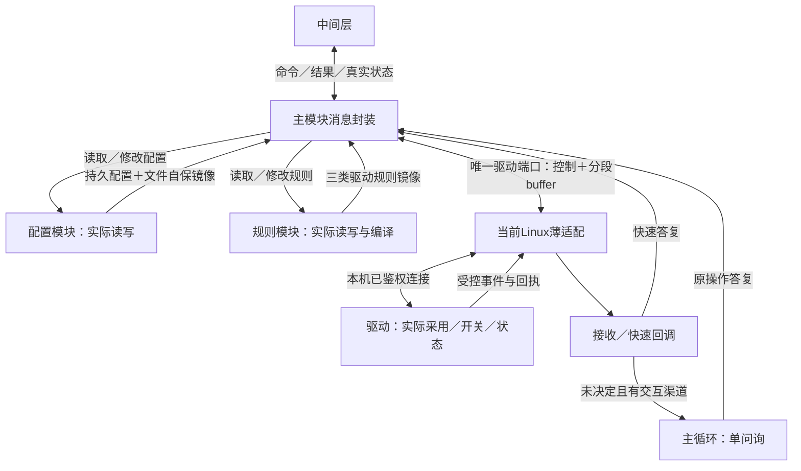

# 主模块消息与驱动通信架构

产品边界见[设计](design.md)，字段与传输见[技术契约](technical.md)。

## 初始化编排

1. 主模块首先调用ConfigModule::initialize()。配置模块内部一次定位真实后端、派生并缓存自保根与ConfigPaths，读取／校验固定配置；InstallLayout不出该模块。
2. 主模块通过snapshot()读取配置、shared_paths()取得同一只读路径引用，组合MainContext；不再次获取目录或拼接路径。
3. 主模块按[规则初始化接口](../../backend/rules/technical.md#普通规则的独立源与下发结构)传入MainContext与Interaction出口，规则模块只使用接口参数中已有rules_file，不导入配置模块实现或从安装布局再派生路径。
4. 主模块先prepare唯一进程树取得宿主boot_id（尚未启动观察／扫描），再按[适配输入](../../backend/driver-adapter/technical.md#平台接口边界)通过底层DriverAdapter建立并核验唯一驱动连接，读取真实能力与状态，不先宣布保护正常。
5. 主模块调用配置模块prepare_driver_config(capabilities)和规则模块prepare_driver_policy(capabilities)，取得各自不可变镜像及版本租约；本机原生对象由内核驱动按协议数据实际绑定；未明确的跨来源绑定先存档，不让主模块造占位参数。
6. 主模块接好接收／快速回调、主循环和消息队列，配置／规则模块先登记候选版本，再调用驱动初始化接口提交两个模块结果。
7. 驱动完整采用并确认版本、默认开关和自保状态后，主模块确认所有必需初始化成功，才对外宣布就绪。先于确认到达的候选版本事件也必须能精确选版。

失败按已初始化资源的逆序调用模块清理接口，不以旧实现或观察模式替代。未开发的模块不返回虚假初始化成功；不关闭外部Root broker。

主模块在上述正式采用前实际完成基础观察启动、进程树整机扫描和事实栅栏，详见[模块初始化衔接](../../backend/process-tree/architecture.md#初始化衔接)。源端通过同一鉴权会话先接事实队列、开启观察，再开始扫描；不能先扫描后订阅，也不能用先启动业务再补树规避初始化职责。

## 消息封装在主模块内

主模块私有消息组成分为中间层端口、驱动端口和明确路由，不是另一个业务服务或通用总线。上行／下行DTO和鉴权入口已由这里收口，不保留独立消息业务所有者或叠加第二个封装；平台I/O留在薄适配，配置／规则内容留在所属模块；功能模块仅通过公共契约参数协作，主模块组合接口，详见[模块边界](../../architecture.md)和[MainContext](../main-context.md)。

底层接到SetRuntimeFeature后，鉴权并转为驱动命令；确认仅来自驱动答复。驱动主动StateChanged由底层转发中间层。查询也读取真实驱动状态，不能用配置中的默认值填补驱动失联。

## 所有者与持久性

- 配置模块独占真实后端定位、自保根与全部固定路径的派生／缓存，并拥有配置文件、版本、一份只读缓存、候选／在途租约和驱动持久配置导出；其中包括文件级自保规则。
- 规则模块拥有普通规则文件、DriverPolicyImage及候选／在途租约；不接管配置模块的持久自保设置。
- 主模块拥有共同开关／状态的管理入口、鉴权、命令关联和转发，不保存另一份可编辑配置或规则。
- 内核DriverCore拥有实际有效持久镜像和临时覆盖；临时值是执法投影，实际状态由驱动报告。底层最近状态只读，不能自行写成“已生效”。

配置文件自保规则编入文件类驱动池的只读系统组1；规则模块的文件驱动组2为同源维护放行，普通文件驱动组从3开始。进程、网络仍各自独立。相同类别内依旧首条编号命中，不增加第四类规则池，不让一条规则同时属于两个来源。

## 三个业务执行职责

驱动内通讯／消息子类的边界以[驱动内部组合](../../drivers/architecture.md#内部子类与组合)为准：原生收发和驱动命令分派不复制主模块的中间层业务封装。[进程生命周期事实](../../drivers/linux/hooks.md#进程树必需的生命周期hook)仍走同一接收泵和快速事实接口，不新增一条业务循环。

接收／快速回调上下文保持唯一逻辑驱动接收泵，短处理回执关联和事件分流；不编译规则、读盘或等人工。主循环继续串行慢匹配及单问询。消息线程处理中间层命令、模块调用、状态和日志，异步等待结果，不占住回答和停止处理。

持久修改在现有消息职责内串行组织，避免配置更新与规则更新相互覆盖；各模块仍独立校验和保存自己的源。运行期开关、查询、原操作答复不等待大镜像传输或持久发布锁。分段间让出发送机会，不新增一条按类别划分的业务线程。

## 两种更新

持久更新由主模块调用所属模块写入，再取得配置／规则两份一致的当前镜像下发。驱动完整校验后短临界区替换。普通持久重载保留临时覆盖；初始化才清空覆盖并采用持久默认。

临时开关由中间层经主模块消息入口下发，只改变指定普通防护类别；不调用配置／规则保存接口，不取消文件自保。恢复默认与明确临时开启是两个不同操作，不能在持久默认为关闭时把“恢复默认”报告为已开启。

保存与驱动采用分别是事实。修改命令只有完成真实保存及必需应用才整体报告成功；失败报告文件版本和实际驱动版本，不假定回滚，也不把已保存说成已生效。不能热采用的变更明确返回需要重新初始化，不自动重启。

## 大缓冲及退出寿命

同一会话最多一个未完成大镜像，使用同一命令ID分段。驱动暂存只是一份待采用镜像，没有匹配能力、文件持久化、跨会话续传或另一套事务服务。最后片段到齐且校验通过才提交；停止／故障会使旧候选失效。

正常关闭先停外部生产者，主模块登记唯一管理入口并关闭接纳；先排空已接受的有限命令，保留其实际写入和采用所需会话。之后Quiesce继续接收和答复，排空原请求及回执，再关闭会话／加载器、Fast线程及消息消费者。Failed不因Quiesce或普通重载变成允许；恢复需要明确完整初始化。取消等待不遗弃已开始的写入、发布或退役工作。

底层DriverSession管理用户态连接资源；内核DriverCore管理实际有效状态和等待。两边只通过协议协作，接口参数以[底层适配](../../backend/driver-adapter/technical.md)为准；DriverContext只在[驱动内部文档](../../drivers/linux/context.md)维护。
