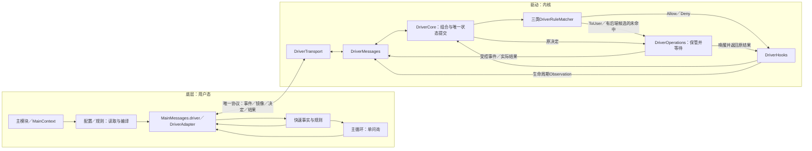

# 驱动与底层的模块边界

产品行为见[驱动设计](design.md)，驱动内部规范见[技术契约](technical.md)，底层连接接口见[驱动适配](../backend/driver-adapter/technical.md)，跨边界数据见[通信契约](../contracts/driver-communication/technical.md)。文档的职责归属就是后续代码边界，不按同一个仓库或当前目录名混合实现。

## 两个大模块的边界

**驱动大模块**是BPF／原生内核执行部分。负责实际hook事实、同类驱动快规则、原对象保管和合法等待、原生端点、驱动协议处理、配置投影／临时值的实际采用，以及真实状态和结果。驱动自己的上下文只在[DriverContext](linux/context.md)定义，不复用或接收底层MainContext。

**底层大模块**是Rust服务及其用户态平台适配。负责配置／规则文件及版本、规则编译、MainContext、三条用户态执行职责、记住／快速／询问规则、人工渠道、进程树／日志／流量模块接口。DriverAdapter、DriverSession、DriverControl及MainMessages.driver／DriverPort都在底层；它们加载或连接驱动并通过协议调用，不是驱动内部类。

两边只通过一条已鉴权的本机协议通道传数据。Rust事件／决定类型与原生视图遵循同一共享规范，通用协议不传内核指针、MainContext、DriverContext、FD／HANDLE或模块实例；运行时来源不能把采样地址／FD变成任意写入权限，见[来源边界](linux/flow-binding.md)。驱动的实际有效投影与底层的已保存配置是不同事实，不互相伪装成已生效。

## 内部子类与组合

驱动唯一原生入口DriverCore负责组合以下内聚单元；各单元技术细节独占对应文档，架构页只确定调用和所有权。

- [DriverHooks](linux/hooks.md)：采样实际hook参数，并在该回调中通过当前任务上下文与内核公开API取得所需事实；保持原执行点并执行最终返回，不匹配或解析协议。
- [DriverRuleMatcher](linux/rules.md)：按EventKind选择ProcessDriverRules／FileDriverRules／NetworkDriverRules，共用算法和已采用只读视图；不读文件、编译源或独立发布版本。
- [DriverSelfProtection](linux/self-protection.md)：系统自保对象和可信服务实例绑定，不建第二文件池；普通匹配与实际状态提交仍由各自既有职责执行。
- [DriverConfiguration](linux/configuration.md)：验证配置镜像及临时命令语义；无配置文件、匹配器或可写状态副本。
- [DriverTransport](linux/transport.md)：原生端点的真实连接身份与帧I/O；不执行报文中的业务命令。
- [DriverMessages](linux/messages.md)：协议结构校验、分片和类型分派；不修改有效状态、不实现中间层业务。
- [DriverOperations](linux/operations.md)：唯一原请求记录、原生引用、期限、合法等待和一次性结果；不查询进程树或识别MCP。
- [DriverTools](linux/tools.md)：无状态进程身份查询和指定身份终止；不持有上下文／策略、不改变原操作决定，DriverCore负责鉴权／接纳。
- [来源边界](linux/flow-binding.md)：受控套接字入口和原生运行时观察已有对应代码；被动TLS采样及管道消息控制尚未实现。不另建DriverTrafficSource服务，不在内核解析协议或替换工具结果。
- [DriverContext](linux/context.md)：DriverCore一次创建的不可变会话输入；不是可写状态、服务集合或调度器。

DriverCore是驱动模块入口函数与本实例状态的组合，不是新的Owner服务。类表示职责边界，不要求C++继承、每类一线程／一个驱动，也不强制每个小类拆独立文件。配置、通讯、消息等不能因都要使用状态而各自保存一份。

### 公共事实采集

普通入口通过原 `start_at → capture` 填充同一事件的公共信息，各hook只补自己的差异载荷。BPF 在既有候选／开关预检查后，以当前hook的局部标量缓冲预采 mount namespace 和用户原生栈；Native 最终采用和规则匹配仍独立执行，预检查不授予裁决权。`finish → capture_execution` 只对需要上报的原记录采 syscall／内核栈并纳入已取得的用户栈。`append_process_info` 和 pid 向量函数统一公共进程／线程字段编码。生命周期入口显式传入真实actor或child，不能一律替换为current。可睡眠与不可睡眠入口共用事实定义，调用API必须符合各自上下文和锁约束，不为统一函数强行增加等待。

这组函数是DriverCore私有实现，不增加新模块、第二份进程缓存或独立队列。主动采集来源、当前覆盖与待补点只在[Hooks采集契约](linux/hooks.md#回调内主动事实采集)维护，字段仍只在公共事件契约定义。

### 普通文件gate组合

[文件产品范围](design.md#普通文件模块范围)共用DriverCore一个私有File gate：Hooks只交实际参数，Core按真实操作执行必要Self修改准入，再交原FileDriverRules，ToUser仍由同一DriverOperations保管／答复。该gate不是新增子类服务、线程、公共上下文或文件规则缓存；字段只引用[事件契约](../contracts/events.md#普通文件gate字段与操作来源)。

同一物理hook只挂一个AS入口。mkdir／unlink／rmdir／rename的self-only薄包装已被self-first普通入口替换，未叠加两份检查／事件；Open合并原路径。Self继续独占真实对象／身份和修改权限，Matcher继续只读匹配，Operations继续唯一原请求寿命。FD写、truncate、link、metadata、mmap/mprotect、mount等不同检查点的自保未因这次合并删除。

底层适配只转码能力／事件／答复；规则模块负责Driver与Backend操作可用性和同源维护行；Main只选择File接口并组合原快／慢路径，不捕获路径、不造文件Owner。具体锁／引用／可等待入口见[Hooks](linux/hooks.md#普通文件gate接线)，不在架构页复制执行算法。

## 数据流与原操作

驱动快规则Allow／Deny命中后在原执行点直接裁决。ToUser或未命中但仍有后端候选时才登记原请求；无候选按原规则契约默认放行。移交时填约定事件中真实可得字段，快速上抛后在合法原生路径等待；不能先让hook返回0。底层收到事件后异步处理，仍由同一驱动原请求保管操作，决定回原会话并竞争同一次收尾。

创建／exec成功／最终组退出只上报事实，不注册待决原操作，不等待人工。源期限、取消、来源故障与回答都仍有效，单个底层弹窗不能冻结其他容器的驱动快速裁决。

## 一份状态与明确临界区

DriverCore独占[DriverRuntimeState／DriverPersistentSnapshot](technical.md#有效状态与原子提交)和唯一有效快照指针。配置验证、规则视图准备、消息重组都只产生候选；DriverCore提交时检查完整性、预期持久代和来源状态，短临界区一次采用，禁止半份配置或三池分别切换。

驱动匹配只读快照，在途原请求保留原版本；没有最后一个使用者退出前不释放。持久替换保留提交时临时覆盖，完整Initialize才采用持久默认；驱动状态不是底层配置布尔值的复制品。

DriverOperations独占待决表与一次性收尾，短锁只处理登记、绑定、状态竞争和摘除；原生等待、慢查询、编译、日志和copy_to_user不持该锁。还要核对hook调用者的锁依赖，不能只证明驱动自己的锁已释放。

DriverTransport独占实际读者缓冲与帧I/O；DriverMessages独占单会话未完大消息。它们不持原请求锁完成大候选分配／校验，也不占住原答复和停止的保留容量。当前使用core_lock短锁与不可变快照引用计数；原记录／观察／控制写任务在真实释放后才降寿命计数。大候选分配和校验在锁外，停止命令通过lifecycle_epoch使旧候选失效。

## 生命周期与管道

进程树必要的创建、exec成功、组退出hook及字段映射见[DriverHooks](linux/hooks.md#进程树必需的生命周期hook)。基础事实不依赖前端、普通防护开关或规则日志；完整停机才按实际加载寿命解除。树算法、存量快照、遗漏核实属于底层事实模块，驱动不再建一棵树。

管道仍属于文件目标类别，权限检查和MCP内容控制必须分别核实。管道的真实hook、字节位置和消息保管缺口只在[管道契约](linux/hooks.md#管道hook与mcp消息拦截)定义。MCP解析／重组／替换在底层流量模块；驱动不能用fexit采样、整管道封禁或事后杀进程冒充消息级拦截。当前Flow观测／错误反馈DTO见[联合契约](../backend/flow/technical.md)；主线不以接管启动或原有pipe为前提，新增能力仍未实现。

## 底层适配与加载退出

主模块读配置和规则后组合DriverConnectInput，底层DriverAdapter实际加载／核验／连接，取得真实DriverInfo；底层再分别导出镜像、接好接收出口并通过DriverSession发送InitializeDriver。驱动验证并采用后回复，底层才宣布初始化完成。失败停止，不回退旧协议或观察模式。

驱动负责原生接纳／等待／结果排空；底层DriverSession负责本进程FD／HANDLE、加载器、BPF link和接收任务。双方各释放自己取得的资源。一个用户态接收／快速处理职责可消费多个原hook，不按类别增线程；卸载顺序保持先停止接纳、收尾并解除调用者，再释放原生模块，保留外部Root broker及发行版已有LSM。

当前as_core.c、as_protocol.h、as_hooks.bpf.c、as_self_protection.c／.h及as_tools.c／.h属于驱动。用户态加载及TLS接纳组件源码收敛在[底层驱动适配的native目录](../../crates/backend/as-driver-adapter/native/README.md)，不混入内核子类。as_flow.h只定义BPF与适配共享的原生值布局；FD接纳报文只定义于底层私有as_tls_ingress.h，内核不消费它。内核模块文件名仍为as_wait.ko。部署仍按既有deb／rpm与DKMS方案，不扩充安装／升级服务。

规则模型可随真实驱动操作／字段调整，前端使用自然语言显示全部规则字段并显式设置生效位置，产品语义见[规则设计](../backend/rules/design.md)。唯一策略字段、阶段动作和消费链以[整体规则契约](../backend/rules/technical.md#驱动接入与既有规则的整体一致性)为准；驱动子类只实现自己的Driver阶段，不另定义用户规则。

规则终止在DriverOperations封住原操作后调用DriverTools的绑定pid入口，策略采用者cred由同一不可变快照持有；两项尝试完成才发布结果。原生收发线程仅保存决定，不实际杀进程、不另建执行队列。结果沿既有上行和日志请求链携TerminationReport，详情只见[原操作契约](linux/operations.md#终止与释放)。
