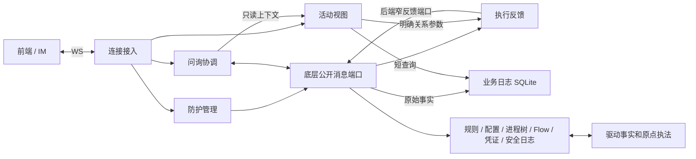

# 中间层架构

[产品设计](design.md)说明业务目的；[技术契约](technical.md)唯一维护新增WS封套和业务关系结构。底层事实仍直接引用[既有唯一契约](../README.md#跨模块契约的唯一出处)，不在中间层重建。首期正式 WS 接入范围见技术契约。

## 内聚模块

1. **连接接入**：拥有 Unix／WS 传输、首次鉴权交换、请求关联、订阅和发送队列。权限及问询可用状态由原 Main Connection 持有。接入层借用只读观察接口来路由，不保存另一份可用标记。规则裁决、LLM 协议和业务因果由各自模块处理。
2. **防护管理**：保护概览组合原状态。Unix 和正式 WS 的规则、配置、临时控制和凭证沿同一接纳入口提交给 Main；持久写入和驱动采用由底层所有者执行。中间层仅保管当前命令及其原回执，私有回执绑定发起连接。[管理契约](technical.md#防护管理)
3. **问询协调**：转发原Ask、选择实际可答复渠道、交回原答复及分发真实结果；临时保留路由所需的原身份，不拥有OriginalOperation、规则期限或超时动作。上下文读取失败不阻止原Ask展示。不负责向LLM写反馈。
4. **活动与因果审计**：消费原始协议、聊天、进程及操作结果，构建有证据的因果关系链和只读查询视图。按业务日志的已提交原事实查询；协议解析、进程树和容器发现沿底层原事实接口。

5. **执行反馈**：将有明确工具执行关联的实际拒绝交给Flow回传规则原文，消费固定文本及真实结果，不生成提示词、不裁决／重匹配规则、不承担Ask答复或HTTP写入。直接Deny与Ask最终Deny走同一接口；详见[该模块架构](execution-feedback/architecture.md)。

6. **业务日志**：拥有 Session／聊天业务解析与组织，数据库子层独占聊天、工具、关系与真实交互业务信息的结构化持久事务。纯业务投影和 SQL 读写各自封装，配置提供唯一固定路径；查询短事务结束后返回原类型，消费完成即释放。底层安全日志独立；原操作结果按业务日志契约保存，不以是否已经关联工具或Ask拒收。详见[业务日志](business-log/architecture.md)。

7. **Agent 调用图谱（Group）**：核对 Agent 间的原请求、任务终态和模型交换。持续旁路原件经唯一业务数据库提交，正式 WS 读取结果。[图谱架构](agent-graph/architecture.md)

容器视图归活动与因果审计，凭证管理归防护管理。各模块通过显式参数和窄接口组合，模块边界及事实所有权沿底层现有接口。

## 业务覆盖

| 业务 | 中间层模块与现有入口 |
|---|---|
| 客户端身份、会话、订阅 | 连接接入复用 Main 授权。回环 WS 承载问询和聊天工作台，Unix JSONL 承载本机管理与原聊天接口。[transport.rs](../../crates/middleware/as-middleware/src/transport.rs) |
| 保护状态、规则、配置、临时控制和凭证 | 正式 WS 与 Unix 共用同一管理接纳入口。[防护管理](technical.md#防护管理) |
| 运行审计 | ReadOnly 读取原进程树、容器归属及命中。ManageService 读取底层已提交的规则日志和写关闭事实。两者均复用 Main 原端口。[运行审计](technical.md#运行审计) |
| 原 Ask、答复、实际执行结果 | 问询协调转发原消息。原版 OpenClaw 已验证文件 Open、进程 Execute 和 IPv4 TCP Connect／Send 的允许／拒绝；具体原件与环境边界分别保留。[media.rs](../../crates/middleware/as-middleware/src/media.rs) · [原操作现场验收](../evidence/execution-site-capture.md#原版openclaw) |
| 聊天入库、历史和实时读取 | 业务日志组织原 Session 与聊天，数据库子层负责唯一 SQLite。模型 HTTP 和 NativeGateway 沿各自原来源读取，同一内容授权封套返回；前端不解析原 Agent 协议或补关联。[业务日志](business-log/technical.md) |
| 活动审计、Ask 上下文 | 活动视图和审计模块消费原事实。精确工具归因仍缺底层来源，按原 ContextGap 报告。[审计技术模型](audit/technical.md) |
| 拒绝原因反馈 | 执行反馈复用底层规则文本和原操作结果，自动归属等待明确因果来源。[反馈契约](execution-feedback/technical.md) |
| Agent 调用图谱 | 已配置回环范围的 A2A／OTLP 与公开 Gateway 原件沿单一消费者进入业务库。Group 仅解释跨 Agent 委派与终态，不拥有一般 Session／聊天；原公开终态／父回投的既有来源与验收边界沿[图谱契约](agent-graph/technical.md)及[R87冻结证据](../evidence/group-terminal-passive.md#r87-正式验收通过)，不外推当前候选或耐久投递。 |

回答时「记住」沿原规则管理接入，详见[路线图](../roadmap.md#进程树命中计数与重复问询记住选项)。

接口实现、前端完整消费和原始来源分别核对；已有候选接口不等于 Ask 或活动页面已展示候选窗口。当前差异与建议开发顺序统一见[业务缺口](gaps.md)，不由其他模块复制实现补位。

## 状态所有权

底层拥有源事实、原操作、规则版本、真正采用状态、进程树、当前协议工作及秘密。中间层拥有客户端会话、请求关联、问询路由和结构化持久业务事实／关系，不建立聊天回放缓存。前端／IM只保存展示状态，不补关系或解释新的执行结果。

原记录按底层类型完整传递。当前进程查询不能覆盖历史事件，消息终态不能覆盖来源缺口，发送成功不能替代执行回执；业务视图的关系不反写为底层事实。底层来源退役／丢失时，相应引用和派生关系标明不可再完整读取，不使用当前同名对象填补。

## 调度与连接生命周期

底层消息接收持续运行，独立于等待某个回复、启动应用、查询详情、写日志或发送客户端。接入模块通过有界队列交业务处理；命令／问询与大体积聊天输出分流。同任务内有多个future时必须确保实际消费者能被poll，队列暂满时由原在途所有者等待现有容量，真实关闭或错误才结束必要输出；Group和命中计数的独立来源损失仍按所属契约报告；已经读取的事件沿驱动适配原保管链交付，不按枚举挑选可丢类型，也不推定客户端缓慢。

每条WS连接首先取得服务端验证的授权，逐命令及敏感写出重核。远端角色不能由消息自报，底层IPC已鉴权也不代表所有WS客户端获权。订阅和原问询绑定到实际连接；断开／撤权释放相应底层能力，不把旧Ask交给另一个客户端答复。多个客户端只接收其权限允许的同一真实终态。

as-service 组合本机 Unix 管理和显式启用的回环 WS。接入模块处理握手与首条认证消息，Main 按当前配置核实凭证并给实际会话登记独立 Connection。Media 维护已登记连接的路由，原授权、可答复状态和单活动问询继续由 Main 拥有。[首次鉴权](technical.md#首次鉴权与真实底层授权)

正式接入首先组合连接接入与问询协调，使用原 `Up::Ask`、`Down::Answer` 和 `Up::OperationResult`。活动视图只提供可选的上下文查询，未取得精确工具来源时仍可转发原问询及裁决结果。首轮接入顺序见[技术契约](technical.md#5-交付顺序与来源缺口)。

接入模块只持连接状态、命令关联及正在发送的原消息。全局只有 Main 的一个活动问询。问询协调保留该问询的发送目标，Main 保管一次性答复能力；连接释放必须传递到原 Main 授权。普通广播共享原不可变值，接收方拥有各自有界输出，控制消息和聊天消费继续独立推进。业务库由实例唯一初始化，增加 WS 连接不重复消费 Flow 或初始化数据库。

退出先封新连接和新应用请求，撤下问询可用性。Unix 和 WS 原订阅在原内容授权下继续读库。底层 Flow 和入库消费者退出后，宿主以 SQLite 最后提交游标结束订阅，随后释放连接和数据库。底层仍负责原操作和内部资源的实际退役。[停机契约](technical.md#聊天订阅停机收尾)

Agent发起者、证据关系、Ask最近20条及底层内存／中间层JSON边界统一遵守[审计分层](audit/architecture.md)，业务字段仅在[技术模型](audit/technical.md)维护，不另行定义。

## Gateway 共用接入与业务投影

这里的 Gateway 适配是同一中间层进程内的窄适配，不是新增服务或采集器。部署仍只有原驱动事件通道、`Media::consume_group` 单一消费者和唯一业务库；前端／IM只消费业务查询结果。完整 MainContext 及组合边界直接引用[唯一契约](../contracts/main-context.md)。

原 `NativeGroupTcp` 字节、socket 与实际 I/O 事实由原采集和驱动适配提供。现有 `collect`／`collect_gateway` 核 TCP、HTTP Upgrade、双向进程与 WS 原件；公共 Gateway 协议解码从 Group 业务分支收敛到一个私有窄入口。业务日志的 Session／聊天投影和 Group 的委派投影借用同一已解析原文档，不互相访问实现或各自重解析。业务日志 facade 组合两份投影及原件，交唯一 SQL 事务；SQL helper 不承担协议识别或选择会话的业务判断。[窄入口与来源](technical.md#nativegateway-共用来源与解析入口)

业务日志内的纯 Session／聊天子模块有明确独立职责：解释原字段对象与已证明的引用交接。它不拥有 SQLite、线程、订阅、可写全局状态或聊天历史；`database/sessions.rs` 只负责相应结构化值和引用的保存、选择及重建。该划分复用现有业务日志 owner，不另设会话服务。[具体落点与运行时顺序](business-log/architecture.md#session聊天的纯业务子模块)
