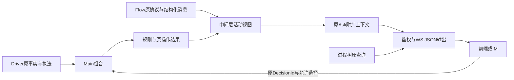

# 审计数据与交互边界

产品目的见[设计](design.md)，新增业务结构唯一见[技术契约](technical.md)。现有公共事实仍以[文档索引](../../README.md#跨模块契约的唯一出处)指定的模块定义为准，不创建第二套事件、消息、规则或进程身份。

## 唯一所有者

- Driver：原操作、实际hook上下文、规则快裁决、保管和真实回执。没有聊天JSON、会话图或业务关联器。
- 驱动适配：验证真实源、持有原生资源，解码唯一内核协议后交EventData。不能补造Agent品牌或工具身份。
- Main：初始化、调度、鉴权、公开接口组合和原Ask／答复路由。不解析provider正文、不组合20条上下文、不计算关联分数。
- 进程树：真实实例、初始／最新属性和有来源的进程关系。当前父子快照不自动成为历史创建因果；树不保存“该进程当前工具调用”。
- Flow：受控TLS、HTTP／JSON／SSE单次协议解析、原始证据、原生字段及有来源的结构化消息投影。原协议字节和投影相互引用；不拼业务会话或Ask上下文。
- 中间层活动视图：独占同交换、问询完成及显式因果关系的事实校验，供联查和业务日志共同使用。组合证据引用及独立命令核对，构造固定来源范围内的20条窗口。模式匹配复用同一SQLite所有者和窗口读取函数，不另建历史缓存或改变原始确证关系；Ask查询直接组合候选及其原消息引用。上下文沿独立业务回复引用原 DecisionId，执行反馈只消费明确桥。
- 中间层接入：远端授权、对外JSON组装／序列化及WS发送。前端／IM只展示与提交选择，不自行推定关系。

当前进程树查询沿独立的 Down::Processes／QueryReply 直接返回；活动 SourceRecord 尚未承载进程查询事实，不在图中假设已经入库或补进历史事件。

实现依赖保持单向：中间层依赖底层公开端口和公共值；底层不导入中间层。MainContext不增加当前聊天、工具、候选关系或可写模块对象。

## 内存路径与JSON边界

同进程模块之间使用借用、Arc及不可变结构化对象；队列传引用，移交后不改原事实。普通事件和聊天元数据不经“转JSON再解析”交接。大块证据字节只在必要的协议解码／跨进程边界复制，不为了广播逐订阅深复制。

LLM上游本身是JSON／SSE，Flow必须解析其协议字段保真；这不等于底层应组装前端JSON。中间层直接消费原ChatEvent、ProtocolObservation等内存对象，不再次解析原协议或构造同义DTO。

Unix JSONL 和正式回环 WS 共用中间层 transport 与 codec，Main 只暴露类型化原值及原连接授权。WS 承载原问询、聊天实时订阅和活动联查。跨进程 JSON 由中间层接入组装。[接入契约](../technical.md)

## 资源与实时性

HIPS快速裁决和人工答复不得等待聊天拼接、审计关联或WS序列化。持有原操作的是Driver，聊天资源不足不能变成允许／拒绝条件。

协议半帧、解压、跨片协议解析是 Flow 有限在途工作。队列仅保尚未出队容器；反馈保管只含已明确发起写事务的必要状态。消费完成立即释放，没有回放池、整交换倍数预约或聊天快照缓存。

中间层业务日志使用结构化 SQLite 保存聊天、关系和交互事实；原事实入库与展示分别完成，Ask 不等提交或上下文查询才显示。查询结果只存活于当前工作，不成为常驻内存历史。

## 界面消费职责

前端归因wire复用原context身份和后端结构，候选表单是Ask／活动共用的私有组件，不另做关联算法。各自原EvidenceRead保管本次请求条件、CommandId和实际回复；新选择、取消、离页或失权立即失去旧回执消费资格，查询结果不进入常驻缓存。

完整窗口仅索引当前ContextView中的原消息引用，复用OriginalChatMessage；不请求后端另一份最新正文来覆盖冻结修订，不深拷贝正文。跳转由ReviewSession核实当前读槽和原交换引用后调用原ChatHistory入口。

内容读取资格仍由原连接及ReviewSession的chatContent单owner维护。当前内容请求收到unauthorized后，清理各内容读槽但保留原拒绝回执，不影响原Ask答复和管理操作；迟到回复不能撤销新连接资格。不增加按页授权缓存。

## 局部关系与补充时序的同一出口

现ActivityContext及ContextView是唯一业务出口。EvidenceRelation复用kind/from/to/evidence承载关系，kind明确区分原协议/执行交接、原始request引用与补充时序匹配；不为每种证据另建图服务、表或DTO副本。NativeObservation只引用既有NativeRequestHandoff.observation，原raw仍由原业务日志表单份保管，索引值只服务同事务查询。

原request引用关系及补充时序由后端在当前短SQL事务机械派生，依据直接引用现source_records。前端只消费及展示所给关系/原值/缺口，不重新按TID或时间找父工具。新增模式不被执行反馈或Ask.trigger_call作为ToolExecution采用；已实现协议关系与20条窗口继续原算法。驱动/Main不导入业务关联模块，本轮不扩大采集或更改原保护动作。
