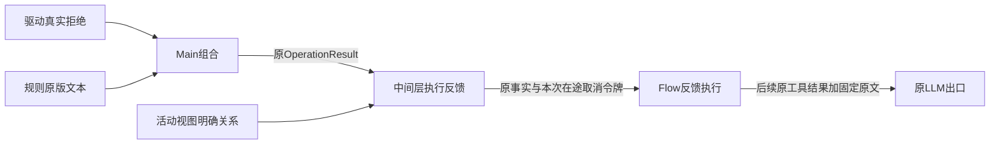

# 执行反馈架构

这是中间层的内聚子模块，负责将规则原文交给对应LLM工具结果；不是独立服务或新的裁决层。产品目的见[设计](design.md)，消费契约见[技术](technical.md)。

## 唯一职责

- 规则模块拥有提示词编辑、校验、增删改查、原子保存、内容修订和原命中版本的固定文本；复用原规则管理入口和PolicyLease，不建提示词专用接口或第二份规则缓存。
- 驱动拥有实际阻止／终止，只报告真实裁决及原命中身份。反馈所需拒绝事实不由日志开关吞掉；内核不存提示词、不解析LLM协议。
- Main 从原租约补 Driver 命中文本并上报真实完成，不重新创建反馈权限、文本缓存或事实源。
- 中间层活动视图拥有有依据的工具执行关系；执行反馈通过参数接收该关系和原OperationResult，产生限定反馈请求。问询协调只管原Ask／Answer与展示结果，不代替此模块。
- Flow拥有等待使用的反馈上下文、原工具引用、有限正文保管、provider字段定位、修改和真实提交事实。它不重新匹配规则，也不把中间层关系结论写成原始内核事实。

所有共享结构以[规则](../../backend/rules/technical.md#固定拒绝提示)、[Flow公共契约](../../contracts/flow.md#固定规则拒绝反馈目标契约)和[Main消息](../../backend/main/messages/technical.md#flow-输出及内容授权)为唯一出处。实现只通过这些值和窄接口组合，不相互导入私有实现。

## 数据流与生命周期

正式服务沿现有完成消息和聊天消费链接线；不增加反馈队列、聊天缓存或事件副本。通用工具语义来源与此执行接线分别认定。

Media 在 consume_chat 首次调用时安装 Main 传入的本实例 FlowFeedbackPort；聊天消费结束／失败时取消该消费源尚未完成的反馈。完成消息消费者只调用一次 Main 的 operation_result 投影，SQL 写入、执行反馈和前端分发共用同一 Arc<OperationResult>，不分别重建 RuleHit／提示词。原 MainNotice 保管到 Flow 校验结束；SQL 写入失败仍转交原完成，反馈失败不改写原结果，不留完成快照。缺关系不登记写事务，不阻止原完成向前端转交。

业务库保留真实完成和明确关系。执行反馈取得原 notice、call、message 和 observations 后，通过显式传入的 FlowFeedbackPort.prepare 发起一次进程内事务。它不借用前端会话或内容查看权限；Flow 校验这些原值及实际认证域后释放完整输入，只保留本次写事务必需的引用、固定文本、认证域和取消令牌。原始结构唯一见[RuleFeedbackPrepareInput](../../contracts/flow.md#固定规则拒绝反馈目标契约)。

路由计划必须在对应工具结果提交前到达。Flow不为普通聊天等待中间层，也不暂停已经拒绝的原操作等待反馈；没有计划时保持现有采集／转发。已有计划只针对其原工具引用匹配一次后续合法请求，不把文本灌入所有聊天。

受影响请求在发送前保管本次改写所需的正文，规则判定与 Ask 答案独立推进。Flow 在途项沿原 messages 接纳容量保管，不设置计时期限或过期状态；本次反馈的显式取消、来源退役和实际资源不足按原反馈阶段收尾。HTTP／TLS 栈处理实际编码与写出。

中间层业务库拥有已提交反馈阶段与历史去重，Flow 只保管在途事务至真实终态，终态释放。原记录、拟发送内容与已提交事实按原阶段展示。正式 WS 的 Ask 闭环独立于本模块，当前没有通用执行来源时仍交付原拒绝结果。
