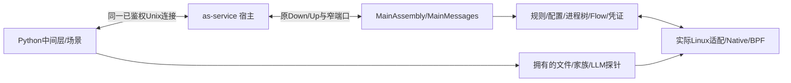

# 脚本化冒烟中间层架构

[产品目的](design.md)与[消息契约](../../backend/main/messages/technical.md)为边界依据。当前代码默认私有、无软件驱动回退；正式Main／规则／进程树／Flow／凭证实现各自保管业务状态。

- Python只持客户端事件／原命令关联、受控子进程及报告，不缓存另一份后端策略，不读写后端配置源。
- 薄宿主只组合MainAssembly、真实LinuxDriverAdapter、固定Unix端点和媒体消费者。首次连接由MainMessages核OS peer；脚本同时核服务OS凭据和实际持有PID。
- [media.rs](../../../crates/middleware/as-middleware/src/media.rs)是宿主和软件冒烟共用的唯一消息消费者；[transport.rs](../../../crates/middleware/as-middleware/src/transport.rs)只维护会话及有界输出，数据库读写继续由原BusinessLog拥有。
- 薄宿主保管一个Unix管理会话和各自鉴权的WS会话，每条会话各有原聊天订阅。重连释放原Connection，同一次问询不会转交另一个会话。现有接入不增加通用注册框架或Owner，也不因Unix入口只有一个会话而限制其他已授权WS连接。
- 普通命令继续原Down／Up；流订阅／私有凭证仅桥接已有窄端口。唯一wire定义在中间层transport，宿主与Python不重新实现鉴权、规则匹配、持久化或TLS解析。
- 同一 Media.run 消费 Main 的完成／状态通知，consume_chat 接管 Flow 唯一 ChatReceiver 写入唯一业务库，两者在原 Messages 职责中独立推进。writer 从 SQL 已提交索引按需取一条原 ChatEnvelope。规则日志由底层安全日志独立消费并返回真实写入结果。source 失效通过明确诊断报告。
- 问询、命令回执和聊天写出异步组织且有界；普通队列满只施加背压，不撤销问询身份。完整帧边界优先控制，单socket已部分写出的JSON不能抢占；慢读仍守原Ask期限，不伪称已展示／已读。敏感帧写出期间继续监督授权，撤权后不续发尚未写出的部分。
- 实际Ask创建后立即交原数据库owner登记写入；控制输出容量与会话EOF只影响发送或等待回执，不取消已接纳SQL工作。问询仍保原期限及超时动作。
- 授权停止使用唯一RequestStop／Accepted语义，Accepted只表示真实宿主已接纳本次停止，不是Main退役完成或进程退出。原命令pending、Output和当前整帧按值移动Main提供的一次性写出能力；它不进入Arc、媒体广播或数据库，只有全部JSONL字节写成功才报告本地written。未写出能力被释放只表示未确认，不撤销已接纳停止。
- 停止仍由薄宿主唯一持有的MainThreads执行：宿主封外部管理并撤原Ask，保内部callbacks，继续poll原session至Accepted真实写出、连接结束或显式取消，再经原shutdown和数据库关闭收尾。敏感半帧仍因真实撤权截断，不强插Accepted；不以网络等待时间冒充失败，显式取消后仍等待同一任务退出。外部实际wait才证明进程退出，传输写出不承担退出监督。

包装／guest初始化是独立脚本职责：标准虚拟文件系统、RTC／hosts／netfilter与匹配Native模块在guest准备；不改宿主模块、nft或信任库。公有provider CA只作为该测试服务子进程的根信任材料，秘密仅走stdin／专属wire。QEMU普通宿主UID与guest真实root分别记录，不伪称broker回执。

脚本化前端与 Unix 冒烟共用场景夹具、请求关联和报告。Python 负责用户流程、原生探针及独立对账；测试用 Rust 客户端只负责一条 WS 连接的握手、消息读写和关闭。两条入口分别使用正式 WS 和 Unix 传输。服务生命周期与 Flow 夹具准备由现有宿主编排负责，验收中的防护操作、问询、聊天和活动查询经正式 WS 完成。
